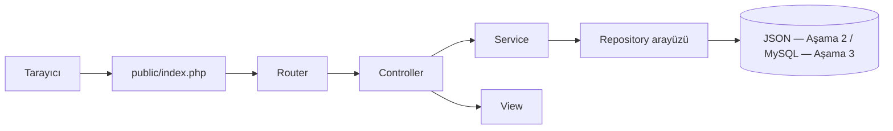
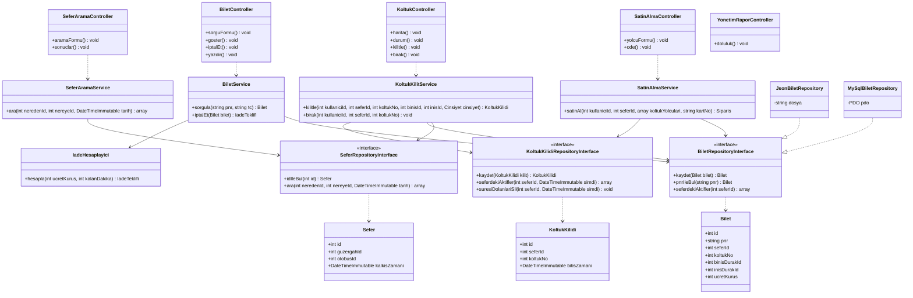
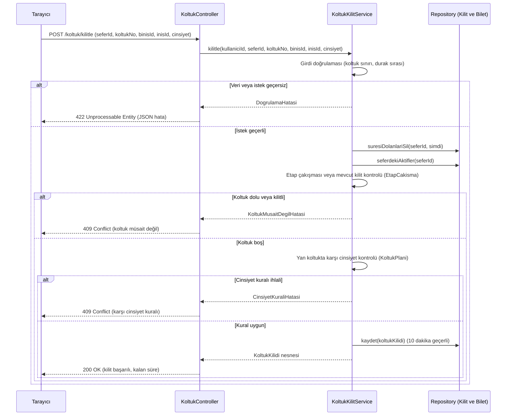
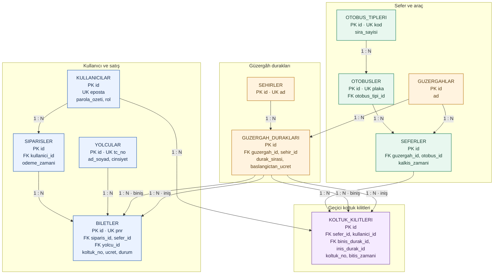
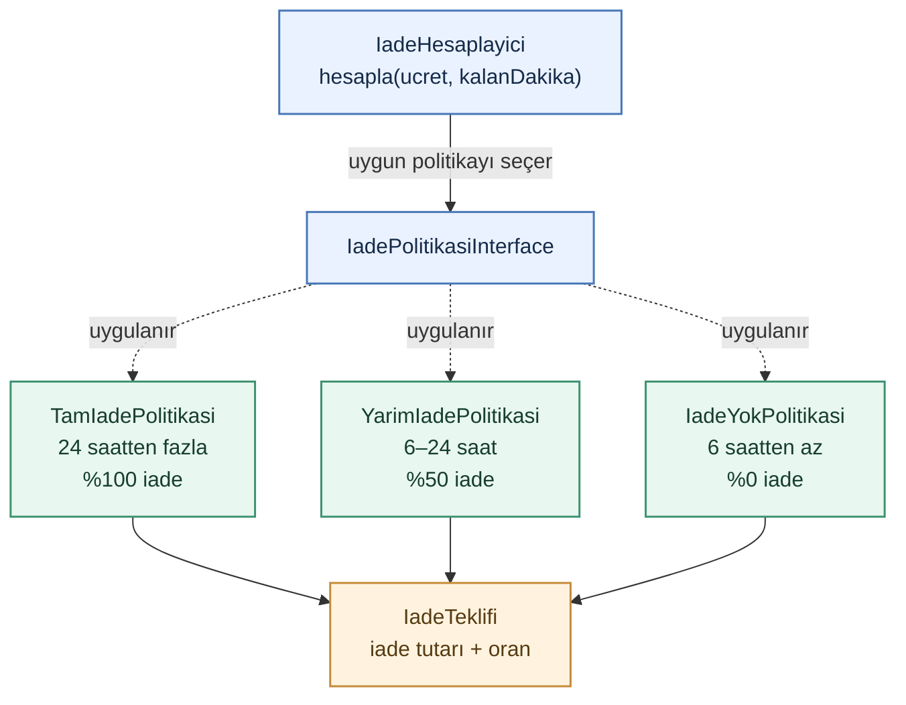
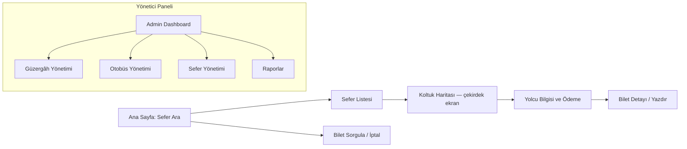

# Otobüs Firması Bilet Satış Sitesi

## Tasarım Belgesi


## Proje Özeti

Sistem, bir otobüs firmasının sefer, otobüs ve güzergâh yönetimini yapmasını; yolcuların ise bilet almasını sağlar. Yolcu **nereden / nereye / tarih** seçerek arama yapar, **koltuk haritasından** koltuğunu kilitler, yolcu bilgilerini girer ve simüle ödeme ile **PNR kodlu bilet** alır. PNR ile bilet sorgulanabilir, iptal ve iade işlemleri yapılabilir.

### Çekirdek Problemler

Bu kurallar sunucu tarafında denetlenir.

| # | Problem                          | Kural / Beklenen davranış                                                                                                                     |
| ---: | -------------------------------- | --------------------------------------------------------------------------------------------------------------------------------------------- |
| 1 | Koltuk çakışması ve geçici kilit | Seçilen koltuk 10 dakika boyunca kilitlenir. Süre dolunca kilit kaldırılır.                                                                   |
| 2 | Duraklara göre segment doluluğu  | Ara duraklı bir seferde (ör. İstanbul–Ankara–Sivas), aynı koltuk İstanbul–Ankara arasında doluyken Ankara–Sivas arasında yeniden satılabilir. |
| 3 | Karşı cinsiyet kuralı            | Aynı ikili grupta, kesişen etaplarda yan yana koltuklar için karşı cinsiyetten yolcu seçimi engellenir.                                       |
| 4 | İptal ve iade politikası         | Kalkışa kalan süreye göre iade uygulanır: **24 saatten fazla %100**, **6–24 saat %50**, **6 saatten az %0**.                                  |

---

## 1. Mimari

İstek akışı aşağıdaki gibidir. Her katman yalnızca kendisinin altındaki katmanı çağırır.



### 1.1 Katmanlar ve Sorumluluklar

| Katman         | Görevi                                                                         | Yapmaması gerekenler                       | Sınıf örnekleri                                                                                                                                                                                                                                 |
| -------------- | ------------------------------------------------------------------------------ | ------------------------------------------ | ----------------------------------------------------------------------------------------------------------------------------------------------------------------------------------------------------------------------------------------------- |
| **Router**     | Adrese göre ilgili Controller metodunu seçer.                                  | İş kuralı içermez.                         | `POST /koltuk/kilitle` → `KoltukController::kilitle`                                                                                                                                                                                            |
| **Controller** | `$_POST` / `$_GET` verisini alır, servisi çağırır, View seçer veya JSON döner. | SQL yazmaz, hesap yapmaz.                  | `KimlikController`, `SeferAramaController`, `KoltukController`, `SatinAlmaController`, `BiletController`, `YonetimGuzergahController`, `YonetimOtobusController`, `YonetimSeferController`, `YonetimRaporController`                            |
| **Service**    | İş kurallarını ve çekirdek algoritmaları yürütür.                              | `$_POST` okumaz, HTML üretmez, SQL yazmaz. | `KoltukKilitService`, `KoltukHaritasiService`, `SatinAlmaService`, `BiletService`, `IadeHesaplayici`, `SeferAramaService`, `SeferService`, `GuzergahService`, `OtobusService`, `KimlikService`, `RaporService`                                  |
| **Repository** | Veriyi okur ve yazar.                                                          | İş kuralı içermez.                         | `KullaniciRepositoryInterface`, `GuzergahRepositoryInterface`, `OtobusRepositoryInterface`, `SeferRepositoryInterface`, `YolcuRepositoryInterface`, `SiparisRepositoryInterface`, `BiletRepositoryInterface`, `KoltukKilidiRepositoryInterface` |
| **Model**      | Veriyi taşıyan sade nesnelerdir.                                               | Veritabanı sorgusu içermez.                | `Kullanici`, `Guzergah`, `Otobus`, `Sefer`, `Yolcu`, `Siparis`, `Bilet`, `KoltukKilidi`                                                                                                                                                         |
| **View**       | HTML görüntüler ve veriyi escape eder.                                         | İş kuralı ve veri çekme içermez.           | `views/seats/map.php`, `views/seferler/list.php`, `views/biletler/show.php`                                                                                                                                                                     |

### 1.2 Klasör Yapısı

```text
otobus-bilet/
├── bootstrap.php
├── composer.json
├── phpunit.xml
├── public/
│   ├── index.php
│   └── assets/
├── src/
│   ├── Controller/
│   ├── Service/
│   │   └── Iade/
│   ├── Repository/
│   │   ├── Json/
│   │   └── MySql/
│   ├── Model/
│   └── Support/
├── views/
├── database/
│   ├── schema.sql
│   └── seed.sql
├── storage/
├── tests/
└── docs/
    ├── tasarim.md
    └── wireframes/
```

> **Veritabanı değişim kontrolü:** Veritabanı veya depolama türü değiştiğinde yalnızca `src/Repository/` altındaki somut sınıflar ile `bootstrap.php` güncellenir. Controller, Service ve Model katmanlarına dokunulmaz.

---

## 2. Sınıf Diyagramı

Mimari kurallara uygun olarak Controller’lar Repository’lere doğrudan erişmez; Service katmanı üzerinden haberleşir.



---

## 3. Sıralama Diyagramı — Koltuk Kilitleme Akışı

Çekirdek problemin kilit adımındaki katmanlar arası çağrı sırası ve hata durumları:



---

## 4. ER Diyagramı ve Normalizasyon

### 4.1 ER Diyagramı



> **İlişki okuma anahtarı:** `||` tek kaydı, `o{` sıfır veya daha çok kaydı, `|{` bir veya daha çok kaydı belirtir. Örneğin `KULLANICILAR ||--o{ SIPARISLER`, **bir kullanıcının sıfır veya çok sayıda siparişi** olabileceği anlamına gelir (1:N).

### 4.2 3NF Normalizasyon Gerekçesi

| Normalizasyon | Gerekçe                                                                                                                                                                |
| ------------- | ---------------------------------------------------------------------------------------------------------------------------------------------------------------------- |
| **1NF**       | Tüm hücreler atomiktir. Biletler tekil satırlarda tutulur; dizi veya virgülle ayrılmış metin saklanmaz.                                                                |
| **2NF**       | Her sütun birincil anahtara (PK) tam bağımlıdır. Birleşik doğal anahtarlar yerine yapay `id` birincil anahtar olarak seçilmiştir.                                      |
| **3NF**       | Anahtar olmayan sütunlar arasında geçişli bağımlılık yoktur. Yolcu adı ve cinsiyeti `YOLCULAR` tablosundadır; otobüs kapasitesi `OTOBUS_TIPLERI` üzerinden belirlenir. |

> **Satış anı kaydı istisnası:** `BILETLER.ucret` sütunu 3NF ihlali değildir; biletin satıldığı andaki maliyeti kaydeder. Güzergâh fiyatı ileride değişse bile eski bilet tutarı korunur.

---

## 5. Tasarım Desenleri

### 5.1 Repository Pattern 

| Başlık         | Açıklama                                                                                                                  |
| -------------- | ------------------------------------------------------------------------------------------------------------------------- |
| **Problem**    | Veri erişiminin depolama türünden (JSON veya MySQL) bağımsız olması gerekir.                                              |
| **Uygulama**   | `BiletRepositoryInterface`, `SeferRepositoryInterface` vb. arayüzler ve bunların `Json*` / `MySql*` uygulamaları yazılır. |
| **Alternatif** | Servisler içinde doğrudan SQL veya `file_get_contents` kullanmak.                                                         |
| **Neden?**     | Veritabanı değiştiğinde yalnızca Repository sınıfları değişir; iş kuralları etkilenmez.                                   |

### 5.2 Strategy Pattern (İade Politikası)

| Başlık         | Açıklama                                                                                                                     |
| -------------- | ---------------------------------------------------------------------------------------------------------------------------- |
| **Problem**    | Kalkışa kalan süreye göre %100, %50 veya %0 iade hesaplanır; kurallar değişebilir.                                           |
| **Uygulama**   | `IadePolitikasiInterface` arayüzünden `TamIadePolitikasi`, `YarimIadePolitikasi` ve `IadeYokPolitikasi` sınıfları türetilir. |
| **Alternatif** | `if / elseif / else` blokları kullanmak.                                                                                     |
| **Neden?**     | Yeni bir iade kuralı, mevcut koda dokunmadan yeni bir politika sınıfı eklenerek uygulanabilir (Open/Closed Principle).       |

#### Strategy sınıf diyagramı



---

## 6. Arayüz Tasarımı

### 6.1 Sayfa Haritası




## 7. Risk Yönetimi

| # | Risk                                                      | Olasılık | Etki   | Önlem                                                                                                              |
| ---: | --------------------------------------------------------- | -------- | ------ | ------------------------------------------------------------------------------------------------------------------ |
| 1 | Eşzamanlılık nedeniyle aynı koltuğun iki kişiye satılması | Orta     | Yüksek | Satır kilitleme (`FOR UPDATE` / `flock`) ve kilit adımlarının sunucu tarafında yeniden doğrulanması                |
| 2 | Ara duraklı satışlarda etap çakışma hatası                | Orta     | Yüksek | `EtapCakisma` sınıfı için sınır durumlarını kapsayan PHPUnit birim testleri yazılması                              |
| 3 | Ödeme sırasında 10 dakikalık kilit süresinin dolması      | Orta     | Orta   | Satın alma adımında sürenin sunucuda yeniden kontrol edilmesi; süre dolduysa kullanıcının haritaya yönlendirilmesi |
| 4 | Yan yana koltuklarda cinsiyet kuralının hatalı çalışması  | Orta     | Orta   | `KoltukPlani` yardımcı sınıfının 2+1 ve 2+2 düzenleri için ayrı birim testlerle doğrulanması                       |
| 5 | TC Kimlik No doğrulama algoritması hatası                 | Düşük    | Orta   | Resmî kuralları ve mod10 / mod11 kontrollerini kapsayan PHPUnit testleri yazılması                                 |
| 6 | Kapsamın büyümesi ve sürenin aşılması                     | Yüksek   | Orta   | SRS dışındaki özelliklerin (gerçek ödeme, SMS gönderimi) kesin olarak kapsam dışında tutulması                     |

---

