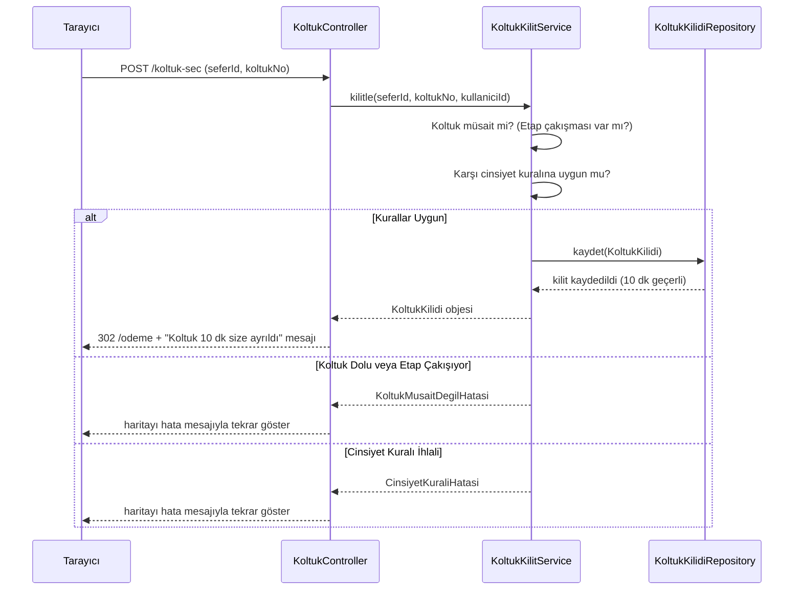
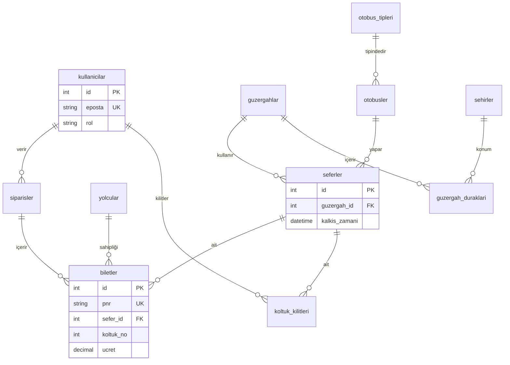
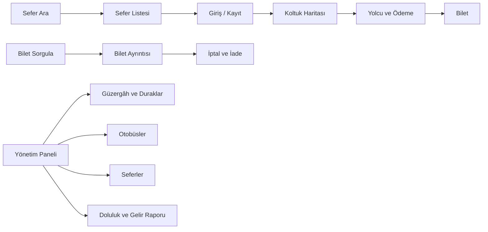

# Otobüs Bilet Sistemi - Tasarım Belgesi

Bu belge Otobüs Bilet Sistemi projesinin yazılım tasarım detaylarını içermektedir.

## 1. Mimari
Projemiz 6 katmanlı bir mimari kullanmaktadır. Her istek şu yoldan geçer: 
**Router → Controller → Service → Repository → Model → View**

| Katman | Görevi | Asla Yapmaz | Otobüs Projesi Örneği |
| :--- | :--- | :--- | :--- |
| **Router** | Adrese göre controller seçer | İş kuralı içermez | POST /koltuk-sec → KoltukController::sec |
| **Controller** | İsteği alır, servisi çağırır | SQL yazmaz, hesap yapmaz | KoltukController |
| **Service** | İş kuralları, çekirdek algoritma | $_POST okumaz, HTML üretmez | KoltukKilitService::kilitle (10 dk kilit) |
| **Repository** | Veriyi okur ve yazar (Arayüz) | İş kuralı içermez | KoltukKilidiRepositoryInterface |
| **Model** | Veriyi taşıyan sınıf | Veritabanına erişmez | Bilet, Sefer, KoltukKilidi |
| **View** | HTML'i gösterir | Hesap yapmaz, veri çekmez | views/biletler/show.php |

**Klasör Yapısı:**
```text
src/
├── Controller/
├── Service/
├── Repository/
├── Model/
views/
docs/
```

## 2. Sınıf Diyagramı
Çekirdek akışı ve bilet işlemlerini barındıran temel sınıf diyagramımız.

```mermaid
classDiagram
    class KoltukController {
        +sec() void
        +haritaGoster() void
    }
    class KoltukKilitService {
        -KoltukKilidiRepositoryInterface repo
        +kilitle(int seferId, int koltukNo, int kullaniciId) KoltukKilidi
    }
    class BiletService {
        -BiletRepositoryInterface repo
        +iptalEt(string pnr) bool
    }
    class KoltukKilidiRepositoryInterface {
        <<interface>>
        +kaydet(KoltukKilidi kilit) void
    }
    class BiletRepositoryInterface {
        <<interface>>
        +pnrIleBul(string pnr) Bilet
        +kaydet(Bilet b) void
    }
    class Bilet {
        +int id
        +string pnr
        +int seferId
        +int koltukNo
    }
    class KoltukKilidi {
        +int id
        +int seferId
        +int koltukNo
        +DateTime bitisZamani
    }
    
    KoltukController ..> KoltukKilitService
    KoltukKilitService --> KoltukKilidiRepositoryInterface
    BiletService --> BiletRepositoryInterface
    KoltukKilidiRepositoryInterface ..> KoltukKilidi
    BiletRepositoryInterface ..> Bilet
```



## 3. Sıralama Diyagramı
Çekirdek problemimiz olan **"Geçici Koltuk Kilitleme ve Hata Durumları"** (Cinsiyet/Çakışma kuralları) akışı.



## 4. ER Diyagramı
11 tablodan oluşan 3NF kurallarına uygun veritabanı şeması.


**3NF ve Etap Doluluğu Gerekçesi:** 
Ad ve cinsiyet verileri sadece `yolcular` tablosunda; plaka verisi sadece `otobusler` tablosunda tutularak veri tekrarı önlenmiş ve 3NF sağlanmıştır. "Bilinçli istisna" olarak `ucret` bilgisi satış anını sabitlemek için `biletler` tablosunda tutulmaktadır. Etap dolulukları için biletlerde biniş ve iniş durakları saklanmakta; etaplar yalnızca `a1 < b2` ve `b1 < a2` koşullarında çakışmaktadır.

## 5. Tasarım Desenleri
**1. Repository Deseni**
* **Problem:** Veritabanına (MySQL) doğrudan bağımlı olmak kodun test edilmesini ve gelecekte farklı bir depolama türüne geçmeyi zorlaştırır.
* **Desen:** `BiletRepositoryInterface` arayüzü ve bunu uygulayan `MySqlBiletRepository`, `JsonBiletRepository` sınıfları.
* **Alternatif:** Tüm SQL kodlarını Controller veya Service içine yazmak (Spagetti kod).
* **Neden:** Veri erişim mantığını iş mantığından ayırır, depolama sistemi değiştiğinde sadece repository sınıfı değişir.

**2. Strategy Deseni**
* **Problem:** İptal işlemlerinde iade oranının süreye göre (24 saat, 6 saat altı vb.) farklı şekillerde hesaplanması gerekliliği.
* **Desen:** `IadePolitikasiInterface` arayüzü ve bunu uygulayan `TamIadePolitikasi`, `YarimIadePolitikasi`, `IadeYokPolitikasi` sınıfları.
* **Alternatif:** İç içe geçmiş uzun `if / elseif / else` zincirleri kullanmak.
* **Neden:** Yeni bir iade kuralı eklemek istediğimizde mevcut koda hiç dokunmadan yeni bir sınıf eklemek yeterli olacaktır (Open/Closed Prensibi).

## 6. Arayüz ve Sayfa Haritası
Kullanıcı akışları, bilet işlemleri ve yönetici paneli geçişleri.


*(Ekran taslakları (Wireframes) docs/wireframes klasöründe resim olarak yer almaktadır.)*

## 7. Riskler
| Risk | Olasılık | Etki | Önlem |
| :--- | :--- | :--- | :--- |
| Aynı koltuk iki kişiye satılır | Orta | Yüksek | Sefer kilidi + transaction, çift tarayıcı testi |
| Etap çakışma hatası | Orta | Yüksek | EtapCakisma sınır testleri |
| Ödemede kilit süresi dolar | Orta | Orta | Sunucuda yeniden denetim, sahte saat testi |
| İade sınır hatası | Orta | Yüksek | Kuruş (int), 24:00 / 6:00 / 5:59 testleri |
| Kapsam büyümesi | Yüksek | Orta | SRS kapsam dışı listesine sadık kalmak |
| TC kimlik verisi sızması | Orta | Yüksek | Maskeleme, loglamama, PNR + TC sorgusu |
| Üye katkısızlığı, çakışan değişiklik | Orta | Yüksek | Haftalık toplantı, PR ve inceleme |

## 8. Plan ve Backlog
Tüm gereksinimler (FR-01'den FR-16'ya) GitHub Projects üzerinde önceliklendirilmiş ve ekip üyelerine atanmıştır.
* **Pano Bağlantısı:** [GitHub Projects Pano Linkimiz]
* **Kilometre Taşları:** Sunum 1, Sunum 2, Sunum 3
