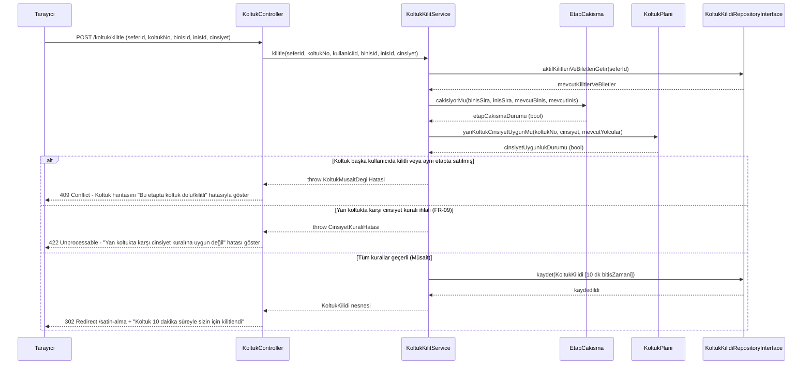
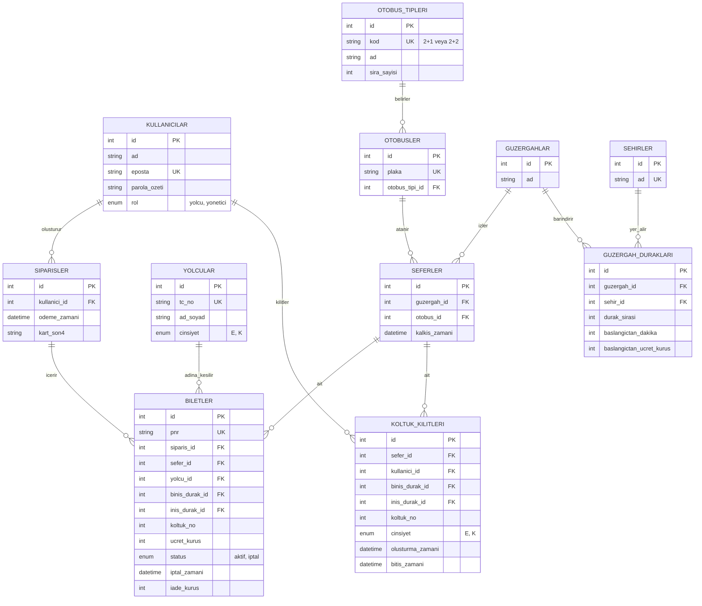
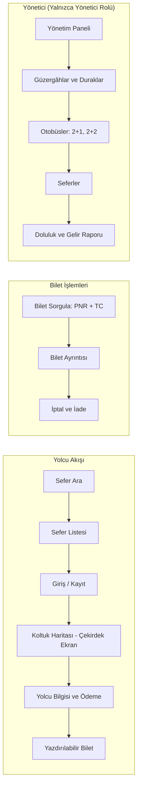

# Otobüs Bilet Sistemi – Yazılım Tasarım Belgesi (`docs/tasarim.md`)

**Grup Üyeleri ve Sunum 1 Görev Dağılımı (3 Kişi):**
* **Üye 1 (Metehan Bayram - Proje Yöneticisi & Mimar):** Proje özeti, Çekirdek Problem, Mimari (Bölüm 1), Sınıf Diyagramı (Bölüm 2) ve Tasarım Desenleri (Bölüm 5)
* **Üye 2 (Mustafa Efe Kaya - Veritabanı ve Test Sorumlusu):** Sıralama Diyagramı (Bölüm 3), ER Diyagramı ve 3NF Gerekçesi (Bölüm 4)
* **Üye 3 (Osman Nuri Gönültaş - Arayüz ve Dokümantasyon Sorumlusu):** Sayfa Haritası ve Ekran Taslakları (Bölüm 6), Risk Analizi (Bölüm 7) ve Backlog (Bölüm 8)

---

## 1. Mimari

Her HTTP isteği aynı katmanlı yoldan geçer: **`public/index.php` → `Router` → `Controller` → `Service` → `Repository` → `Veri (JSON / MySQL)`**[cite: 1, 3].

* **Çekirdek Yol:** `KoltukController` → `KoltukKilitService` → `KoltukKilidiRepositoryInterface`[cite: 3]
* **Veritabanını değiştirsek ne değişir?** Yalnızca `MySql...Repository` sınıfları, `PdoIslemYoneticisi` ve `bootstrap.php` değişir. `Controller`, `Service`, `Model` ve `View` sınıfları kesinlikle değişmez[cite: 3].

| Katman | Görevi | Asla Yapmaz | Otobüs Bilet Sistemi Örneği |
| :--- | :--- | :--- | :--- |
| **Router** | Adrese göre hangi controller metodunun çalışacağını seçer, CSRF ve rol yetkisini denetler | İş kuralı içermez | `POST /koltuk/kilitle` → `KoltukController::sec` |
| **Controller** | `$_POST`/`$_GET` verisini alır, servisi çağırır, görünümü seçer | SQL yazmaz, fiyat/etap hesabı yapmaz | `KoltukController`, `SatinAlmaController`, `BiletController` |
| **Service** | İş kuralları ve çekirdek algoritma (10 dk kilit, etap çakışması, karşı cinsiyet kuralı, iade) | `$_POST` okumaz, HTML üretmez | `KoltukKilitService`, `SatinAlmaService`, `BiletService`, `IadeHesaplayici` |
| **Repository** | Veriyi okur ve yazar (Aşama 2 JSON, Aşama 3 MySQL PDO) | İş kuralı içermez | `BiletRepositoryInterface`, `KoltukKilidiRepositoryInterface` |
| **Model** | Veriyi taşıyan sade sınıf ve Enum'lar | Veritabanına erişmez | `Bilet`, `KoltukKilidi`, `Sefer`, `Yolcu`, `Cinsiyet`, `BiletDurumu` |
| **View** | HTML'i gösterir, çıktıyı kaçışlar (XSS önleme) | Hesap yapmaz, veri çekmez | `views/biletler/show.php`, `views/koltuklar/harita.php` |

### Klasör Yapısı
```text
otobus-bilet/
├── public/
│   └── index.php
├── src/
│   ├── Controller/
│   ├── Service/
│   │   └── Strategy/
│   ├── Repository/
│   ├── Model/
│   ├── Support/
│   └── Exception/
├── views/
├── database/
├── tests/
├── docs/
│   ├── tasarim.md
│   └── wireframes/
├── storage/
└── composer.json
```

---

## 2. Sınıf Diyagramı

Projemizde toplam 61 sınıf, arayüz ve enum bulunmaktadır[cite: 11]. Aşağıdaki UML sınıf diyagramı çekirdek koltuk kilitleme, bilet satış/iptal ve Strategy/Repository tasarım desenlerini oluşturan **22 temel sınıfı** ve ilişkilerini göstermektedir:

```mermaid
classDiagram
    direction TB

    class KoltukController {
        -KoltukHaritasiService haritaService
        -KoltukKilitService kilitService
        +haritaGoster(int seferId) void
        +sec(int seferId, int koltukNo) void
    }
    class SatinAlmaController {
        -SatinAlmaService satinAlmaService
        +odemeFormu() void
        +satinAl() void
    }
    class BiletController {
        -BiletService biletService
        +sorgula(string pnr, string tcNo) void
        +iptalEt(string pnr) void
        +yazdir(string pnr) void
    }

    class KoltukHaritasiService {
        -SeferRepositoryInterface seferRepo
        -BiletRepositoryInterface biletRepo
        -KoltukKilidiRepositoryInterface kilitRepo
        +haritaGetir(int seferId, int binisId, int inisId) array
    }
    class KoltukKilitService {
        -KoltukKilidiRepositoryInterface kilitRepo
        -BiletRepositoryInterface biletRepo
        -EtapCakisma etapCakisma
        -KoltukPlani koltukPlani
        +kilitle(int seferId, int koltukNo, int kullaniciId, Cinsiyet cinsiyet) KoltukKilidi
        +suresiDolanlariTemizle() void
    }
    class SatinAlmaService {
        -BiletRepositoryInterface biletRepo
        -SiparisRepositoryInterface siparisRepo
        -KoltukKilidiRepositoryInterface kilitRepo
        -OdemeService odemeService
        -TcKimlikDogrulayici tcDogrulayici
        -PnrUretici pnrUretici
        +satinAl(int kullaniciId, array yolcular, array kartBilgisi) Siparis
    }
    class BiletService {
        -BiletRepositoryInterface biletRepo
        -IadeHesaplayici iadeHesaplayici
        +pnrIleSorgula(string pnr, string tcNo) Bilet
        +iptalEt(string pnr) int
    }

    class IadeHesaplayici {
        -IadePolitikasiInterface[] politikalar
        +hesapla(Bilet bilet, DateTimeImmutable simdi) int
    }
    class IadePolitikasiInterface {
        <<interface>>
        +uygunMu(int kalanSaat) bool
        +oranYuzde() int
    }
    class TamIadePolitikasi {
        +uygunMu(int kalanSaat) bool
        +oranYuzde() int
    }
    class YarimIadePolitikasi {
        +uygunMu(int kalanSaat) bool
        +oranYuzde() int
    }
    class IadeYokPolitikasi {
        +uygunMu(int kalanSaat) bool
        +oranYuzde() int
    }

    class BiletRepositoryInterface {
        <<interface>>
        +kaydet(Bilet b) void
        +pnrIleBul(string pnr) Bilet
        +seferBiletleriniGetir(int seferId) array
    }
    class KoltukKilidiRepositoryInterface {
        <<interface>>
        +kaydet(KoltukKilidi kilit) void
        +aktifKilitleriGetir(int seferId) array
        +sil(int kilitId) void
    }
    class MySqlBiletRepository {
        -PDO pdo
        +kaydet(Bilet b) void
        +pnrIleBul(string pnr) Bilet
    }
    class JsonBiletRepository {
        -string dosyaYolu
        +kaydet(Bilet b) void
        +pnrIleBul(string pnr) Bilet
    }

    class Bilet {
        +int id
        +string pnr
        +int siparisId
        +int seferId
        +int koltukNo
        +int yolcuId
        +int binisDurakId
        +int inisDurakId
        +int ucretKurus
        +BiletDurumu status
    }
    class KoltukKilidi {
        +int id
        +int seferId
        +int koltukNo
        +int binisDurakId
        +int inisDurakId
        +int kullaniciId
        +Cinsiyet cinsiyet
        +DateTimeImmutable bitisZamani
    }
    class Sefer {
        +int id
        +int guzergahId
        +int otobusId
        +DateTimeImmutable kalkisZamani
    }
    class Yolcu {
        +int id
        +string tcNo
        +string adSoyad
        +Cinsiyet cinsiyet
    }
    class EtapCakisma {
        +cakisiyorMu(int a1, int a2, int b1, int b2) bool
    }
    class KoltukPlani {
        +yanKoltukNoBul(int koltukNo, string otobusTipiKodu) int
    }

    KoltukController ..> KoltukHaritasiService
    KoltukController ..> KoltukKilitService
    SatinAlmaController ..> SatinAlmaService
    BiletController ..> BiletService

    KoltukHaritasiService --> BiletRepositoryInterface
    KoltukHaritasiService --> KoltukKilidiRepositoryInterface
    KoltukKilitService --> KoltukKilidiRepositoryInterface
    KoltukKilitService --> BiletRepositoryInterface
    KoltukKilitService --> EtapCakisma
    KoltukKilitService --> KoltukPlani
    SatinAlmaService --> BiletRepositoryInterface
    SatinAlmaService --> KoltukKilidiRepositoryInterface
    BiletService --> BiletRepositoryInterface
    BiletService --> IadeHesaplayici

    IadeHesaplayici --> IadePolitikasiInterface
    TamIadePolitikasi ..|> IadePolitikasiInterface
    YarimIadePolitikasi ..|> IadePolitikasiInterface
    IadeYokPolitikasi ..|> IadePolitikasiInterface

    MySqlBiletRepository ..|> BiletRepositoryInterface
    JsonBiletRepository ..|> BiletRepositoryInterface

    BiletRepositoryInterface ..> Bilet
    KoltukKilidiRepositoryInterface ..> KoltukKilidi
    Bilet --> Sefer
    Bilet --> Yolcu
```



---

## 3. Sıralama Diyagramı

Projemizin çekirdek problemi olan **"Koltuk Seçimi, Etap Bazlı Doluluk, Yan Koltuk Karşı Cinsiyet Denetimi ve 10 Dakika Geçici Kilit (FR-07, FR-08, FR-09)"** akışı ve hata dalları:



---

## 4. ER Diyagramı ve Normalizasyon (11 Tablo, 3NF)

Veritabanımız **11 tablodan** oluşmaktadır ve **3NF** kurallarına uygundur[cite: 8]:



### 3NF Gerekçesi ve Etap Doluluğu Açıklaması
1. **1NF, 2NF ve 3NF Uyumu:** Her hücrede tek bir atomik değer tutulmaktadır (1NF). Tüm tablolar tekil `id` birincil anahtarına bağlıdır (2NF). Yolcunun `ad_soyad` ve `cinsiyet` bilgisi yalnızca `yolcular` tablosunda, otobüsün `plaka` bilgisi yalnızca `otobusler` tablosunda tutulur; `siparisler` tablosunda toplam tutar sütunu tutulmayıp `SUM(ucret_kurus)` ile hesaplanır (3NF)[cite: 8].
2. **Bilinçli İstisna (Tarihsel Kayıt):** `biletler` tablosundaki `ucret_kurus` ve `iade_kurus` alanları satış ve iptal anındaki tarihsel kayıttır; ileride güzergâh tarifesi değişse bile satılmış biletin fiyatı değişmemelidir[cite: 8].
3. **Etap Doluluğu Kuralı (FR-08):** Bilet ve koltuk kilidi tabloları biniş ve iniş durağını tutar. İki etap yalnızca `a1 < b2` ve `b1 < a2` ise çakışır[cite: 8].

---

## 5. Tasarım Desenleri

### 1. Repository Deseni (Veri Erişimi - Zorunlu)
* **Problem:** İş kurallarını barındıran servislerin (`BiletService`, `KoltukKilitService`) verinin JSON dosyasında mı yoksa MySQL veritabanında mı tutulduğunu bilmeden çalışması gerekmektedir[cite: 4].
* **Desen:** `BiletRepositoryInterface` arayüzü ve bunu uygulayan `JsonBiletRepository` (Aşama 2) ile `MySqlBiletRepository` (Aşama 3) sınıfları kullanılmıştır[cite: 4].
* **Alternatif:** Servis sınıflarının içinde doğrudan `file_get_contents()` veya `PDO` SQL sorguları yazmak.
* **Neden:** Aşama 2'den Aşama 3'e geçerken veritabanı değiştiğinde `Controller` ve `Service` sınıflarına hiç dokunmadan yalnızca Repository sınıfını değiştirmek yeterli olur[cite: 3, 4].

### 2. Strategy Deseni (İade Politikası - FR-14)
* **Problem:** Bilet iptalinde sefere kalan süreye göre (%100: 24 saat üstü, %50: 6–24 saat arası, %0: 6 saat altı) farklı iade oranlarının hesaplanması gerekmektedir[cite: 4].
* **Desen:** `IadeHesaplayici` sınıfı, `IadePolitikasiInterface` arayüzünü uygulayan `TamIadePolitikasi`, `YarimIadePolitikasi` ve `IadeYokPolitikasi` sınıflarını kullanır[cite: 4].
* **Alternatif:** `BiletService` içinde karmaşık `if / elseif / else` bloklarıyla saat kontrolü yapmak[cite: 4].
* **Neden:** Her iade kuralı kendi sınıfında izole edilir; yeni bir kampanya veya iade kuralı eklendiğinde mevcut kod değiştirilmeden yeni bir strateji sınıfı eklenir ve birim testleri kolaylaşır[cite: 4].

---

## 6. Arayüz: Sayfa Haritası ve Ekran Taslakları

### Sayfa Haritası


### 5 Temel Ekran Taslağı (Wireframes)
1. **Ekran 1 – Sefer Arama ve Sefer Listesi (`FR-05`):** Kalkış/Varış durağı (Açılır liste), Tarih (Date), "Sefer Ara" düğmesi.
2. **Ekran 2 – Görsel Koltuk Haritası (`FR-06, FR-07, FR-09` - Çekirdek Ekran):** 2+1 / 2+2 koltuk dizilimi, Cinsiyet seçimi (E/K), 10:00 geri sayım sayacı, Hata mesajı kutusu.
3. **Ekran 3 – Yolcu Bilgisi ve Simüle Ödeme Formu (`FR-10, FR-11`):** Yolcu Ad Soyad, TC Kimlik No (11 hane), Kart bilgileri, "Ödemeyi Tamamla" düğmesi.
4. **Ekran 4 – PNR ile Bilet Sorgulama ve İptal/İade (`FR-12, FR-13, FR-14`):** PNR Kodu ve TC Kimlik No alanları, "Bileti Yazdır" ve "Bileti İptal Et" düğmeleri.
5. **Ekran 5 – Yönetici Sefer ve Gelir Raporu Ekranı (`FR-04, FR-15`):** Sefer ekleme formu ve Doluluk Oranı (%), Toplam Gelir (TL) tablosu.

---

## 7. Risk Analizi

| Risk | Olasılık | Etki | Önlem |
| :--- | :--- | :--- | :--- |
| **Aynı koltuk iki kişiye satılır** | Orta | Yüksek | Sefer kilidi + veritabanı transaction kullanımı, çift tarayıcı testi |
| **Etap çakışma hatası** | Orta | Yüksek | `EtapCakisma` sınıfı için sınır değer birim testleri (`a1 < b2` ve `b1 < a2`) |
| **Ödemede kilit süresi dolar** | Orta | Orta | Ödeme anında sunucuda kilidin yeniden denetlenmesi, sahte saat (`SaatInterface`) testi |
| **İade sınır hatası** | Orta | Yüksek | Tutarları kuruş (`int`) olarak tutmak, `24:00` / `6:00` / `5:59` sınır testleri |
| **Kapsam büyümesi** | Yüksek | Orta | SRS kapsam dışı listesine sadık kalmak |
| **TC kimlik verisi sızması** | Orta | Yüksek | Ekranda TC maskeleme (`*******1234`), loglamama, PNR + TC ile sorgulama |
| **Üye katkısızlığı, çakışan değişiklik** | Orta | Yüksek | Haftalık toplantı, dal koruması, PR ve kod inceleme (Review) zorunluluğu |

---

## 8. Plan ve Backlog

* **GitHub Projects Backlog Bağlantısı:** Deponun `Projects` sekmesinde yapılandırılmıştır.
* **Kilometre Taşları (Milestones):**
  1. **Sunum 1 (4. Hafta):** SRS, Mimari, UML Diyagramları (`docs/tasarim.md`), Proje İskeleti ve Backlog Kurulumu.
  2. **Sunum 2 (Aşama 2):** JSON tabanlı çalışan prototip, `KoltukKilitService`, `EtapCakisma`, `IadeHesaplayici` ve PHPUnit birim testleri.
  3. **Sunum 3 (Aşama 3):** MySQL (PDO) geçişi, Transaction güvenliği, Yönetici raporları ve son teslim.
